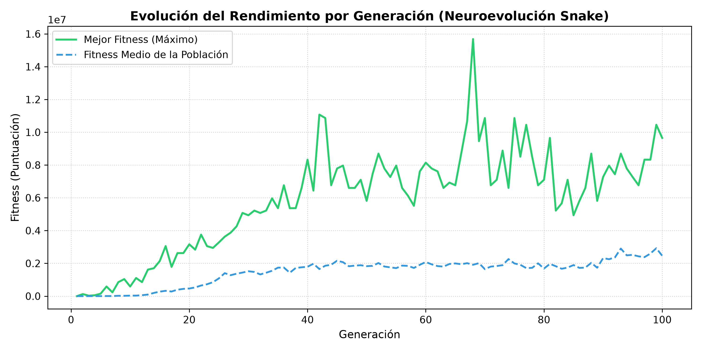

# Neuro-Snake: Optimización de Redes Neuronales mediante Algoritmos Genéticos

Optimización y heurística · Grado en Ciencia e Ingeniería de Datos · ULPGC · 2026-2027

**Sara Dévora Ortega y June Argoitia Aguirrezabalaga**

---

## Descripción del Proyecto

En lugar de utilizar algoritmos de aprendizaje supervisado o descenso por gradiente, este sistema modela cada individuo de una población como una **Red Neuronal Feedforward** cuyos pesos y sesgos forman su cromosoma (ADN). A lo largo de sucesivas generaciones, los agentes interactúan con el entorno y evolucionan mediante selección elitista, cruce uniforme y mutación gaussiana.

### Características principales
* **Entorno interactivo en Pygame:** Tablero de $20 \times 20$ celdas con panel lateral de telemetría en tiempo real (generación, récord histórico, fitness, barra de energía y visualización activa de sensores).
* **Modo doble de ejecución:** Entrenamiento acelerado sin renderizado gráfico (`render=False`) y modo de exhibición en vivo (`watch`) con control dinámico de FPS y pausa.
* **Red Neuronal desde cero en NumPy:** Implementación pura sin *frameworks* externos de Deep Learning para transparentar el proceso matemático de propagación y optimización.

---

## Arquitectura Técnica

### 1. Entorno y Sensores (`src/game.py`)
En cada fotograma, el agente percibe el entorno mediante un vector de 12 variables de entrada:
* **3 sensores de peligro relativo:** Detección binaria de colisión (pared o propio cuerpo) justo delante, a la derecha y a la izquierda de la cabeza.
* **4 sensores de orientación:** Codificación *one-hot* de la dirección actual de movimiento (`Izquierda`, `Derecha`, `Arriba`, `Abajo`).
* **3 sensores de comida relativa:** Indica si la manzana se encuentra delante, a la derecha o a la izquierda respecto a la orientación actual de la serpiente.
* **2 sensores de distancia continua:** Diferencia normalizada en los ejes $X$ e $Y$ hacia la manzana en el rango $[-1.0, 1.0]$.

La red devuelve 3 posibles acciones: `0` (seguir recto), `1` (girar 90° a la derecha) o `2` (girar 90° a la izquierda).

### 2. Red Neuronal (`src/neural_network.py`)
* **Topología:** `12 -> 16 -> 3` (259 parámetros entrenables entre pesos y sesgos).
* **Activación:** Función `ReLU` en la capa oculta y selección mediante `argmax` en la capa de salida.

### 3. Algoritmo Genético y Función Objetivo (`src/genetic_algorithm.py`)
* **Población y Evolución:** 150 individuos por generación durante 100 generaciones, con selección elitista del 15%, cruce uniforme (50% de genes de cada progenitor) y mutación gaussiana ($p = 0.08$, $\sigma = 0.3$).
* **Función de Fitness:** Diseñada para premiar exponencialmente la recolección de manzanas y las trayectorias directas, penalizando el alejamiento y los pasos innecesarios para evitar bucles:
  $$\text{Fitness} = \max\left(0,\; (\text{manzanas}^2 \times 1000) + (\text{manzanas} \times 500) + \text{bonus\_acercamiento} - (\text{pasos} \times 0.2)\right)$$
* **Control anti-bucles:** Límite dinámico de pasos sin comer ($100 \times \text{longitud}$).

---

## Resultados Obtenidos

Tras entrenar durante 100 generaciones con una población de 150 individuos, el algoritmo muestra una clara convergencia ascendente tanto en el fitness máximo como en la media poblacional, alcanzando su pico máximo en la Generación 68 con un récord superior a las 120 manzanas en una sola partida:



---

## Estructura del Repositorio

```text
snake-neuroevolution/
├── src/
│   ├── game.py               
│   ├── neural_network.py     
│   ├── genetic_algorithm.py  
│   ├── plotter.py            
│   └── main.py               
├── models/
│   └── best_brain.npy        
├── results/
│   └── fitness_evolution.png 
├── requirements.txt          
└── README.md                 